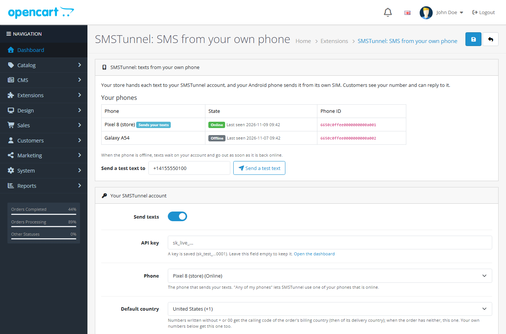

# SMSTunnel for OpenCart

An OpenCart extension that texts you about new orders, and your customers about their own orders, through **[SMSTunnel](https://smstunnel.io)**: from **your own Android phone**, with **your own number**.

Your store hands each text to your SMSTunnel account and your phone sends it from its own SIM, so customers see a number they know and can reply to it. The phone is linked to your account when you sign in to the SMSTunnel app, and you can cut the store off at any time by deleting its API key in your dashboard.

Your phone needs the SMSTunnel app from Google Play:

<a href="https://play.google.com/store/apps/details?id=io.smstunnel.app"></a>

SMSTunnel for OpenCart is not affiliated with, endorsed by, or sponsored by OpenCart Limited. OpenCart is a trademark of OpenCart Limited.

## What it does

- **New order, a text to you.** Up to 5 of your numbers get a short text for every new order: `Your Store: new order #1042 from Ana Pop, $106.00.`
- **Order updates, a text to the customer.** Tick the order statuses that should text the customer (Shipped, Complete, Canceled and Refunded are ticked when you install) and write a text for each one. The customer gets it at the telephone of the order, only about their own order.
- **Your own wording**, with `{firstname} {lastname} {order_id} {total} {store_name} {status} {comment}`. Suggested texts come in English and Romanian; each customer gets the suggestion in the language of the order.
- **A test text** from the settings page, the list of your phones with their state, and a phone picker.
- **Recent texts**: the last texts, whether they went out, what your phone did with them (sent, delivered), and why one did not go out. A text that did not go out can be sent again with one click. Numbers show only their last 2 digits.
- **Checkout never waits for SMSTunnel.** If SMSTunnel cannot be reached, the order goes through, the failure is written down, and you can send the text again later.
- **One text per event.** If OpenCart runs the same event twice, or an order gets the same status again, nothing is sent twice.
- **No texts to numbers that should not get one**: invalid numbers, premium-rate numbers, short codes and satellite networks are skipped.
- Admin pages in English and Romanian.



## Requirements

- OpenCart 3.0.x (tested on 3.0.5.1 with PHP 8.3 and 3.0.3.8 with PHP 7.4), or OpenCart 4.0.2.x and 4.1.x (tested on 4.0.2.3 with PHP 8.2 and 4.1.0.4 with PHP 8.3). The extension's own code runs on PHP 7.1 to 8.5. OpenCart 3.0 also runs on older PHP: there the extension does nothing, its page says which PHP it needs, and checkout is left alone.
- PHP's cURL extension (OpenCart needs it anyway).
- An Android phone with the SMSTunnel app, and an SMSTunnel account.

There are two packages, one per OpenCart generation:

| OpenCart | Package | Note |
| --- | --- | --- |
| 3.0.x | `smstunnel-oc3.ocmod.zip` | Any file name works. |
| 4.0.2.x, 4.1.x | `smstunnel.ocmod.zip` | Keep this exact name: OpenCart 4 names the extension's folder after the file, and another name breaks it. |

## Installation

**OpenCart 3.0**

1. Download `smstunnel-oc3.ocmod.zip` from the [OpenCart Marketplace](https://www.opencart.com/index.php?route=marketplace/extension/info&extension_id=50410) or from the [latest release](https://github.com/narcisbodea/smstunnel-opencart/releases/latest) here.
2. In your admin, open **Extensions > Installer**, click **Upload** and choose the zip. Wait for *Success*.
3. Open **Extensions > Extensions**, choose **Modules**, and click the green **+** next to **SMSTunnel: SMS from your own phone**. Then click the blue pencil.

**OpenCart 4**

1. Download `smstunnel.ocmod.zip` from the [OpenCart Marketplace](https://www.opencart.com/index.php?route=marketplace/extension/info&extension_id=50410) or from the [latest release](https://github.com/narcisbodea/smstunnel-opencart/releases/latest) here (keep the name).
2. In your admin, open **Extensions > Installer**, click the upload button and choose the zip. In the list below, click the green **+** next to SMSTunnel.
3. Open **Extensions > Extensions**, choose **Modules**, and click the green **+** next to **SMSTunnel: SMS from your own phone**. Then click the blue pencil.
4. OpenCart 4 asks for a telephone at checkout only when you turn it on: open **System > Settings**, edit your store, and on the **Option** tab turn on **Telephone Display** and **Telephone Required**. The SMSTunnel page warns you while it is off.

To build the packages from this repository: `bash tools/build.sh` (needs Docker; it writes `build/smstunnel-oc3.ocmod.zip` and `build/smstunnel-oc4/smstunnel.ocmod.zip`).

## Setup

1. Install the [SMSTunnel app from Google Play](https://play.google.com/store/apps/details?id=io.smstunnel.app) on your Android phone and sign in. Sign in at [smstunnel.io](https://smstunnel.io) on your computer with the same account: the phone appears under **Phones** (you can also link it with the QR code from **Phones → Add phone**).
2. In your [SMSTunnel dashboard](https://dashboard.smstunnel.io/apps), open **Apps → Add an app** and copy its key. The key can send texts and look up whether they went out; this extension needs nothing more.
3. On the SMSTunnel page in OpenCart, paste the key into **API key** and save. The page then lists your phones, online or offline. Leave **Phone** on *Any of my phones*, or pick the phone that should send your texts.
4. Check **Default country**: it starts as your store's country. Numbers written without `+` or `00` get the calling code of the order's billing country (then its delivery country), and this one when the order has neither.
5. Under **New orders: a text to you**, add your number in international format (`+14155550123`), up to 5 numbers separated by commas.
6. Under **Order updates: a text to the customer**, tick the statuses that should text the customer and adjust the texts.
7. Save, then use **Send a test text** at the top of the page.

When a phone is offline, texts wait on your account and go out as soon as it is back online.

## How the texts are written

| Placeholder | Becomes |
| --- | --- |
| `{firstname}`, `{lastname}` | The customer's name on the order. |
| `{order_id}` | The order number, such as `1042`. |
| `{total}` | The order total in the order's currency, as your store shows it (`$106.00`). |
| `{store_name}` | The name of the store the order was placed in. |
| `{status}` | The name of the new status, in the order's language. |
| `{comment}` | The comment typed with the status change, only when **Notify Customer** is ticked (so notes meant for you stay with you). OpenCart has no tracking-number field: type the tracking number or link there. |

A placeholder with no value disappears without leaving double spaces, so `... is on its way. {comment}` ends cleanly when there is no comment. A text can be 1600 characters long.

Leave a text as suggested, or empty, and each customer gets the suggested text in the language of the order (English or Romanian), kept up to date by later versions. The suggested texts stay in the basic SMS alphabet: one character outside it (such as `ă` or `ș`) makes each SMS part 70 characters long instead of 160.

## Phone numbers

The customer's number is the telephone of the order. A number written without `+` or `00` is completed with the calling code of the billing country, because the telephone is the customer's own while a parcel can go to someone abroad (then the delivery country, then the **Default country**): in the United States `(415) 555-0123` becomes `+14155550123`, in Romania `0721 123 456` becomes `+40721123456`. Countries whose numbers keep their leading 0 (Italy, San Marino, Vatican, Côte d'Ivoire, Benin, Gabon, Congo) keep it. SMSTunnel also gets the calling code as `defaultCountryCode`.

A number that is not valid in international format, a premium-rate number (such as `+1 900…`, `+44 90…`, `+40 90…`), a short code or a satellite network is skipped: the order goes on, and **Recent texts** says why no text went out. These are the checks of the SMSTunnel WordPress plugin.

## When something goes wrong

Texts are sent while OpenCart saves the order or the status, with short timeouts: 3 seconds to connect to SMSTunnel, 8 seconds in all. If SMSTunnel cannot be reached, the other texts of the same page load are not tried, so a checkout waits at most a few seconds and is never stopped. A PHP warning raised while a text is sent never reaches OpenCart's error handler (which would stop the page). The failure shows in **Recent texts** (with **Send again**), at the top of the SMSTunnel page, and in OpenCart's error log (**System > Maintenance > Error Logs**), without numbers in full, without the words of the text and without the key.

| Message | What to do |
| --- | --- |
| SMSTunnel refused the API key | The key was deleted, mistyped, or its account is suspended. Create a new one under **Apps → Add an app**. |
| This API key may not send texts | The key lacks the permission to send texts. Create a new one under **Apps → Add an app**. |
| Too many texts at once, or the daily limit of your plan is reached | SMSTunnel allows 30 texts a minute per key, and your plan has a daily allowance. Wait, then use **Send again**. |
| SMSTunnel could not be reached | A network or DNS problem between your server and smstunnel.io. Use **Send again** once it is solved. |
| Waiting for your phone | Your phone is offline. The text goes out when it is back online; nothing to do. |
| Not confirmed | The text left for SMSTunnel but no answer came back in time, so it may have gone out. It is never sent again on its own: check **Messages** in your SMSTunnel dashboard, and use **Send again** only if it is not there. |
| Skipped | The order has no telephone, or one that cannot be texted. |
| SMSTunnel for OpenCart needs PHP 7.1 or newer | OpenCart 3.0 runs on a PHP the extension cannot use, so it sends nothing. Ask your host for PHP 7.1 or newer (7.4 or 8.x is best). Then open the SMSTunnel page once: it sets itself up. |

## Several stores

OpenCart can run several stores from one admin. The extension has one configuration for all of them (the key, your numbers and the texts); `{store_name}` is the name of the store each order was placed in, and every store's orders appear in **Recent texts**.

## Privacy and GDPR

The extension sends only transactional texts about orders: a text to your own numbers when an order comes in, and a text to the customer when their order moves to a status you chose. It sends nothing else, and nothing to people who did not order.

What goes to SMSTunnel, and why:

- **To deliver each text**: the recipient's phone number and the text itself, which can contain the customer's name, the order number, the total, your store's name and the status comment, depending on your wording. SMSTunnel passes the text to your phone, which sends it.
- **To identify your store**: your API key, the phone you chose, and the calling code used to complete the number.
- Nothing else: no email address, no postal address, no order contents, no browsing data.

What stays in your store:

- A list of the last 1000 texts in the table `PREFIX_smstunnel_log`: date, kind, order, status, and the error when there was one. Once a text went out (or was skipped), its row keeps only the last 2 digits of the number and none of the words. Only a text that did not go out (or whose sending SMSTunnel did not confirm) keeps the number and the words, so that **Send again** can send it. **Clear the list** empties the list and wipes the remaining numbers and words; it keeps each order text's key (order, status and a hash of the number), so a cleared text is still never sent twice.
- The settings, including the API key, in OpenCart's setting table, like the credentials of other extensions. The key is never shown back in full.

Uninstalling the module deletes the list, the settings and its events.

You are the controller of your customers' data; SMSTunnel processes the texts for you. Customers can reply to the texts: the replies reach your phone.

## Build it with an AI assistant

Want texts the extension does not send, such as a back-in-stock alert or a reminder for an unpaid order? Copy this prompt into Claude, ChatGPT, Cursor or Copilot and replace the part in brackets. Never put a real API key in a prompt.

```text
I run an OpenCart store (OpenCart [3.0 / 4.0 / 4.1]) and want it to send text messages with SMSTunnel.
SMSTunnel sends texts from my own Android phone, from my own number: my code hands each text to my SMSTunnel
account and the SMSTunnel app on my phone sends it from its own SIM.

The extension "SMSTunnel for OpenCart" is installed (Extensions > Installer, then Extensions > Extensions >
Modules > SMSTunnel). It already texts customers about order statuses and me about new orders. Its settings are
in OpenCart's setting table (code module_smstunnel, store 0): the API key in module_smstunnel_api_key, the
optional phone ID in module_smstunnel_device_id and the server in module_smstunnel_api_url (https://smstunnel.io).

SMSTunnel API facts:
- POST https://smstunnel.io/api/v1/sms/send with the headers X-API-Key: <key> and Content-Type: application/json.
- Body: {"to": "+14155550123", "message": "...", "deviceId": "<optional phone ID>", "defaultCountryCode": "<optional, e.g. +1>"}.
  No other fields: the API refuses unknown ones.
- Success: {"success": true, "messageId": "...", "data": {"messageId": "...", ...}}; "queued": true means my phone
  is offline and SMSTunnel keeps the text until the phone is back online.
- One recipient per call: to text several people, send one text to each.
- Up to 1600 characters per text; 30 send requests a minute per key.
- Numbers in international format (+ and country code). defaultCountryCode completes numbers written without + or 00,
  and it always wins over the phone's own country.
- Sign-in and verification codes go to POST https://smstunnel.io/api/v1/sms/send-2fa instead: the text must contain a
  code of 4 to 10 digits standing on its own (e.g. 482913 or 123-456), at most 320 characters.
- GET https://smstunnel.io/api/v1/sms/status/<messageId> says where a text is (pending, sent, delivered, failed).
- Errors are JSON such as {"message": "Invalid or expired API key", "statusCode": 401}, sometimes with a "code":
  401 = wrong or deleted key; 403 = the key lacks a permission (code PERMISSION_REQUIRED) or the plan lacks the
  feature; 429 = too many requests, wait and try again; 5xx = try again later.

What I want: [describe what should send a text, to whom, and when]

Rules for you:
- Write it as a small OpenCart extension of its own, with OpenCart events (no edits to core files or to the
  SMSTunnel extension). Event handlers must return nothing and must catch every exception.
- Keep the API key out of source code, templates and anything sent to the browser: read it from the setting table.
- Use cURL with short timeouts (3 seconds to connect, 8 in all) and catch every error: a text must never stop a
  checkout or an admin page. OpenCart stops a request on any PHP warning, so none may escape.
- Validate numbers and turn them into international format before sending, with the address country's calling code;
  skip numbers that are not valid, premium-rate numbers and short codes.
- Handle the errors above: retry 429 and 5xx later, do not retry 401 and 403. Log failures without full phone
  numbers, without the words of the text and without the key.
- Only send texts people expect from my store, such as order updates, reminders or codes they asked for.
```

## Responsible use

Send only texts that people expect from you: order updates, alerts to yourself, reminders they asked for. Unsolicited messages from a personal SIM break most carriers' terms of service. Please make sure your usage complies with your carrier's terms and with local regulations (in the EU, that includes GDPR and the ePrivacy rules on electronic communications).

## Development

```bash
bash tools/build.sh      # build/smstunnel-oc3.ocmod.zip and build/smstunnel-oc4/smstunnel.ocmod.zip
bash tools/check.sh      # php -l and the unit tests on PHP 7.1, 7.4, 8.1, 8.2, 8.3, 8.4 and 8.5; on PHP 5.6,
                         # php -l of the files OpenCart 3.0 loads first and tests/oldphp (an old PHP: nothing runs)
```

`src/core/smstunnel/` is the code both packages share (the API client, numbers, texts, the list of texts, the order logic, the settings page's logic); `src/oc3/` and `src/oc4/` hold each OpenCart generation's controllers and templates, and `src/language/` the admin wording.

The tests never talk to smstunnel.io. `tests/fake-api/server.mjs` is a fake SMSTunnel API that answers like the real one (send, phones, status; wrong key, 403, 429, 5xx, a proxy page, no answer, a dropped connection) and records every request. The unit tests run against it, and so do the end-to-end tests, which install OpenCart from the official release in Docker, upload the package in **Extensions > Installer**, configure it, place guest orders in the storefront, change their status in the admin and check what the fake API received:

```bash
bash tools/build.sh
node tests/e2e/run.mjs --oc 3.0.5.1     # compose project smst-int-oc3, http://localhost:8731
node tests/e2e/run.mjs --oc 4.0.2.3     # compose project smst-int-oc4, http://localhost:8741, PHP 8.2
node tests/e2e/run.mjs --oc 4.1.0.4     # compose project smst-int-oc4, http://localhost:8741, PHP 8.3

# OpenCart 3.0.3.8 on PHP 7.4, as many older stores run it:
docker build -t smst-int-oc-php74:local tests/docker/php74
node tests/e2e/run.mjs --oc 3.0.3.8 --image smst-int-oc-php74:local
```

Each run removes its store at the end (`docker compose ... down -v`; `--keep` leaves it running) and stops the fake API. Playwright comes from a shared install (`SMSTUNNEL_PLAYWRIGHT`, `SMSTUNNEL_CHROME`). The **SMSTunnel server** field under **Advanced** exists for these tests only; a store keeps `https://smstunnel.io`.

## Changelog

See [CHANGELOG.md](CHANGELOG.md).

## License

GPL-3.0-or-later, © NARBOWEB SRL. See [LICENSE](LICENSE). OpenCart itself is GPL-3.0, and the OpenCart marketplace expects GPL-compatible extensions; both packages carry the license as `LICENSE.txt`.
